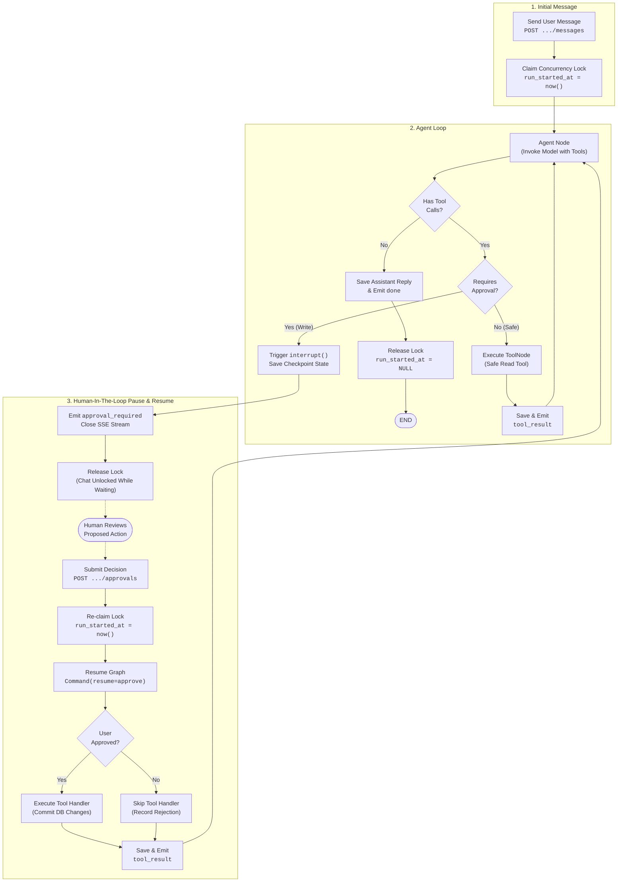

# Conversation

Code location: `src/hr_minds/conversation/`.

The Conversation module is the central store for chat sessions, and it runs the assistant that answers in them. Any part of the platform can keep its chats here: a session is a `Conversation`, and every turn in it is a `Message`. When you send a message, the assistant replies by streaming; it can also call tools that other modules register (see [Assistant](#-the-assistant)).

---

## 🏗️ Concepts

```text
User ──► Conversation (private to the user, inside one organization)
              │  optional context: ("job_posting", "12")
              ▼
          Message, Message, Message ...   (oldest first, ordered by id)
```

### Private to the owner
A conversation belongs to the user who started it, inside the organization that was active (`X-Org-Id`) at the time. Every query filters on both `org_id` and `user_id`, so:
- other members of the organization, **including the organization owner**, can't see it;
- the same user can't see it under a different organization's `X-Org-Id`;
- anything that isn't yours returns `404 Conversation not found`, exactly like a missing id, so existence isn't leaked.

This is deliberate: people will paste candidate details into chats.

### Context
`context_type` and `context_id` say what a chat is about, for example `("job_posting", "12")`. They are optional but go together (both or neither). There is no foreign key to other modules' tables, so this module stays independent, and a context can outlive the thing it points at. [List conversations](API-Endpoints#conversations) can be filtered by either.

### Only `user` messages come from clients
Everything stored in a conversation is later replayed to the model as history, so a client must not be able to forge an `assistant` or `tool` turn. The message request body has no `role` field and rejects unknown fields (`422`); the API always stores `user`. Assistant and tool messages are written only by server code through `conversation.services.conversation.add_message`.

---

## 🗄️ Database Schema

### `Conversation`

| Column | Type | Description |
| :--- | :--- | :--- |
| `id` | `Integer` | Primary key |
| `org_id` | `Integer` (FK → `organization.id`) | Organization the chat belongs to (CASCADE) |
| `user_id` | `Integer` (FK → `user.id`) | Owner (CASCADE) |
| `title` | `String(255)`, nullable | Optional label |
| `context_type` | `String(50)`, nullable | Kind of thing the chat is about |
| `context_id` | `String(64)`, nullable | Which one; a string so any module's ids fit |
| `last_message_at` | `DateTime(timezone=True)` | Creation time, then the time of the latest message; the list sorts by it |
| `run_started_at` | `DateTime(timezone=True)`, nullable | Set while the assistant is answering in this conversation, null when idle; see [one run at a time](#one-run-at-a-time) |
| `created` / `modified` | `DateTime(timezone=True)` | Audit timestamps |

A check constraint requires `context_type` and `context_id` to be both set or both null.

### `Message`

| Column | Type | Description |
| :--- | :--- | :--- |
| `id` | `Integer` | Primary key; also the order within a conversation |
| `conversation_id` | `Integer` (FK → `conversation.id`) | Parent (CASCADE) |
| `role` | `String(20)` | `user`, `assistant` or `tool` |
| `content` | `Text`, nullable | Text of the turn; null for an assistant turn that is only tool calls |
| `tool_calls` | `JSONB`, nullable | Assistant turns: `[{"id", "name", "arguments"}]` |
| `tool_call_id` / `tool_name` | `String(100)`, nullable | Tool turns: which call this answers, and by which tool |
| `model` | `String(100)`, nullable | Assistant turns: which model answered |
| `input_tokens` / `output_tokens` | `Integer`, nullable | Assistant turns: usage; can't be rebuilt later |
| `created` / `modified` | `DateTime(timezone=True)` | Audit timestamps |

Messages use this provider-neutral shape on purpose: whichever model provider is used, an adapter converts to and from it, so switching provider needs no data migration.

**Deleting** a conversation removes its messages (`ON DELETE CASCADE`), and so does deleting the organization or the user.

---

## 🤖 The assistant

`POST /conversations/{id}/messages` saves your message, claims the conversation lock (`run_started_at`), and runs the LangGraph agent loop (`conversation/agents/loop.py`). If the model requests a mutation tool (`requires_approval=True`), execution halts via LangGraph `interrupt(...)` and waits for human authorization:



```text
                               ┌────────────────────────┐
                               │   POST .../messages    │
                               │  (Claim run_started_at)│
                               └───────────┬────────────┘
                                           │
                                           ▼
                                    ┌──────────────┐
                                    │    START     │
                                    └──────┬───────┘
                                           │
                                           ▼
                                     [agent node] ◄─────────────────────────────────┐
                                 (invoke model with tools)                          │
                                           │                                        │
                                ┌──────────┴──────────┐                             │
                      (tool calls)              (no tools)                          │
                                ▼                     ▼                             │
                        [Tool Inspection]           [END]                           │
                          requires_approval?        (done)                          │
                            ┌──────┴──────┐           │                             │
                     (False)│             │(True)     │                             │
                            ▼             ▼           ▼                             │
                      [execute tool] [interrupt]  (release lock)                    │
                            │             │           │                             │
                            │             ▼           ▼                             │
                            │      (save checkpoint) [Stream Closed]                │
                            │      (release lock)                                   │
                            │             │                                         │
                            │             ▼                                         │
                            │     [approval_required]                               │
                            │             │                                         │
                            │             │  Client reviews & calls:                │
                            │             │  POST .../approvals {"approve": bool}   │
                            │             │  (Re-claims run_started_at)             │
                            │             ▼                                         │
                            │     [Command(resume)]                                 │
                            │       approved?                                       │
                            │      ┌──────┴──────┐                                  │
                            │(True)│             │(False)                           │
                            │      ▼             ▼                                  │
                            └──► [execute]   [return rejection]                     │
                                   │                 │                              │
                                   └────────┬────────┘                              │
                                            ▼                                       │
                                     [tool_result] ─────────────────────────────────┘
```

Every step is saved as a `Message` in the database as it happens and streamed to the client as a server-sent event (see the [API Reference](API-Endpoints#post-conversationsconversation_idmessages)).

### Architecture & Components

- **LangGraph StateGraph (`build_graph`)**:
  - The loop is modeled as a `StateGraph(MessagesState)` with two nodes: `agent` (model invocation with tools bound) and `tools` (LangGraph's prebuilt `ToolNode`).
  - `tools_condition` inspects the output: if the model produced `tool_calls`, execution transitions to `tools` and loops back to `agent`; otherwise, it finishes.
  - Stepping limit: Run via `graph.astream(..., config={"configurable": {"thread_id": str(conversation.id)}, "recursion_limit": 2 * MAX_STEPS}, stream_mode="updates")`. Since LangGraph counts every node visit as a step, `2 * MAX_STEPS = 12` ensures at most 6 model iterations (`MAX_STEPS = 6`). A `GraphRecursionError` is caught and emitted as `{"event": "error", "detail": "Stopped after 6 steps without a final answer."}`.

- **Checkpointer & Human-In-The-Loop (`MemorySaver` & `interrupt`)**:
  - The compiled graph is backed by a `MemorySaver` checkpointer keyed by `thread_id=str(conversation.id)`.
  - When a tool has `requires_approval=True`, the tool wrapper calls LangGraph's `interrupt({"tool": tool.name, "arguments": arguments})`.
  - LangGraph freezes the active state inside the checkpointer and emits `{"event": "approval_required", ...}` to the SSE stream.
  - The HTTP handler immediately releases the conversation lock (`run_started_at = NULL`) so the chat is not frozen while awaiting a human decision.
  - The client calls `POST /conversations/{id}/approvals {"approve": true/false}` to resume. The endpoint re-claims the conversation lock and invokes `graph.astream(Command(resume=approved))`.
  - If approved, the tool executes and writes changes; if rejected, the tool execution is skipped and a rejection message is returned to the model so it can adapt gracefully.

- **The model dependency (`get_chat_model`)**:
  - `chat_model()` initializes a `ChatOpenAI` instance pointing to `LLM_BASE_URL` with `LLM_API_KEY` and the model name resolved by `model_for()` from `settings/llm.py` (supporting capability overrides `LLM_MODEL_REASONING` and `LLM_MODEL_FAST`).
  - `get_chat_model()` is the FastAPI dependency for the message endpoint. If settings are incomplete (`LLMNotConfigured`), it yields `{"event": "error", "detail": "The assistant is not configured."}` while keeping the user's message saved.
  - In unit tests, `app.dependency_overrides[get_chat_model] = lambda: None` prevents actual LLM network calls.

- **Tool adapter & permissions (`as_langchain_tools`)**:
  - Tools are registered in `conversation/agents/registry.py` via the `@tool` decorator with names, descriptions, Pydantic argument schemas, and required permissions.
  - `as_langchain_tools(db, membership)` wraps permitted registry tools into LangChain `StructuredTool` instances.
  - **Permissions are verified twice**:
    1. Only tools for which the user holds permissions (`membership.can(*tool.permission)`) are passed to the model.
    2. Before a tool handler executes, the wrapper re-checks permissions; if missing, it returns `{"error": "permission denied"}`.
  - The caller's `Membership` and `AsyncSession` are injected directly by the wrapper—the model never supplies organization or user identifiers.
  - Any `HTTPException` raised inside a tool is captured and returned as `{"error": e.detail}` so the model can explain or adapt.

- **History windowing & broken exchange repair**:
  - `_history()` feeds the model the system prompt (augmented with `context_type` and `context_id` if present) followed by up to 40 recent messages (`HISTORY_LIMIT = 40`).
  - Stored `Message` rows are adapted to LangChain classes: `HumanMessage`, `AIMessage` (mapping `arguments` to `args`), and `ToolMessage`.
  - `_without_broken_tool_exchanges()` filters out orphaned tool calls or tool results that lack their matching pair (caused by history slicing or an interrupted run) to ensure model provider APIs do not reject the payload.

- **Proof-of-Concept loop (`poc_loop.py`)**:
  - `poc_loop.py` is kept in the codebase for POC and personal practice purposes.
  - It demonstrates an alternative, lightweight agent loop implemented from scratch using a raw `while` loop and direct calls to `LLM.chat()`, without LangChain or LangGraph dependencies.
  - The live endpoint uses `loop.py` for structured graph execution and future workflow extensibility.

### Registered Assistant Tools

The assistant has 8 registered tools across modules. Tools are gated by RBAC permissions (the caller's `Membership` must hold the tool's required permission). Read tools execute automatically; write tools pause execution and require human approval before applying changes to the database. There is no delete tool.

| Tool | Module | Description | Required Permission | Approval Needed |
| :--- | :--- | :--- | :--- | :--- |
| `conversation_current_time` | Conversation | Get the current date and time in UTC | `conversation:read` | No |
| `media_list_resumes` | Media | List organization's scanned resumes (20/page, includes resume IDs) | `media:read` | No |
| `recruitment_list_job_postings` | Recruitment | List organization's job postings (20/page) | `recruitment:read` | No |
| `recruitment_get_job_posting` | Recruitment | Get details of a single job posting by ID (company, location, experience, skills, salary) | `recruitment:read` | No |
| `recruitment_create_job_posting` | Recruitment | Create a new job posting with company, title, description, skills, experience, and salary | `recruitment:create` | **Yes** (`requires_approval=True`) |
| `recruitment_update_job_posting` | Recruitment | Update an existing job posting by ID; sending `skills` replaces the entire list | `recruitment:update` | **Yes** (`requires_approval=True`) |
| `recruitment_select_candidate` | Recruitment | Select a scanned resume (`local_media_id`) for a job posting (`job_posting_id`) | `recruitment:create` | **Yes** (`requires_approval=True`) |
| `recruitment_update_candidate_status` | Recruitment | Move a candidate to a new pipeline status (`shortlisted`, `interviewing`, `offered`, `hired`, `rejected`) | `recruitment:update` | **Yes** (`requires_approval=True`) |

#### Approval Flow & Cancellation
- When the assistant calls a write tool (`requires_approval=True`), execution pauses via LangGraph `interrupt(...)`.
- The assistant emits an SSE event `approval_required` with `{tool, arguments}` and closes the stream.
- The client resumes the turn by calling `POST /api/v1/conversations/{id}/approvals` with body `{"approve": true}` or `{"approve": false}`.
- If approved, the tool executes and the rest of the assistant turn streams to completion (`tool_result`, `message`, `done`).
- If rejected, tool execution is skipped, returning a rejection notice to the assistant so it can respond to the user.
- **Cancellation:** Sending a new message to the conversation (`POST /api/v1/conversations/{id}/messages`) deletes the in-flight checkpoint thread, cancelling any pending approval.

### One run at a time
Two simultaneous runs in one conversation would interleave their messages and corrupt the history. A run claims the conversation by setting `run_started_at` with a single `UPDATE ... WHERE run_started_at IS NULL OR older than 5 minutes`; the database makes that atomic, so exactly one request wins and the other gets `409`. The claim is released when the run ends, including when it fails or the client disconnects. A claim older than 5 minutes is treated as dead, so a crashed server can't lock a conversation forever.

---

## 🔐 RBAC & Permissions

The feature slug is `conversation`. Permissions gate who may use the chat at all; ownership (above) then decides which conversations they can see.

| Endpoint | Required Permission |
| :--- | :--- |
| `POST /api/v1/conversations` | `conversation:create` |
| `GET /api/v1/conversations` | `conversation:read` |
| `GET /api/v1/conversations/{id}` | `conversation:read` |
| `PATCH /api/v1/conversations/{id}` | `conversation:update` |
| `DELETE /api/v1/conversations/{id}` | `conversation:delete` |
| `GET /api/v1/conversations/{id}/messages` | `conversation:read` |
| `POST /api/v1/conversations/{id}/messages` (sends a message and streams the reply) | `conversation:create` |
| `POST /api/v1/conversations/{id}/approvals` (submits approval decision and resumes reply) | `conversation:create` |

Tools the assistant calls need their own permission on top of this (for example a recruitment tool needs `recruitment:create`), so the chat can't be used to get around a role.

After adding the feature, run `uv run python -m hr_minds.auth.cli sync-features` so roles can be granted these permissions. Organization owners have them automatically.

---

## 📏 Limits

- Message `content` is trimmed and must be 1 to 20,000 characters.
- `title` is at most 255 characters; `context_type` at most 50; `context_id` at most 64.
- Lists are [paginated](API-Endpoints#pagination): conversations default to 20 per page, messages to 50 (maximum 100 for both).

---

## 🔌 Using it from server code

```python
from hr_minds.conversation.models import MessageRole
from hr_minds.conversation.services import conversation as conversations

conversation = await conversations.get(db, org_id, user_id, conversation_id)  # 404 if not yours
await conversations.add_message(db, conversation, MessageRole.ASSISTANT, "Done.", model="...", output_tokens=42)
```

`add_message` appends the turn and moves `last_message_at` in one transaction. The service functions always take `org_id` and `user_id`, so there is no way to fetch a conversation without them.

For the HTTP specification see the [API Reference](API-Endpoints#conversations).
